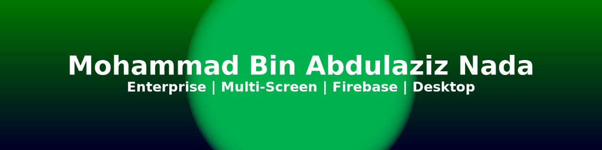

  

  
  
  

## About me

I'm a Computer Science graduate and Flutter developer who ships software people use in front of live audiences, and I also build
full-stack web products with Next.js and Laravel.

- **Now:** Full-Stack Developer at [Nada Tech](https://nadatechno.com) (since June 2026), Ismailia, Egypt.
- **Before:** Flutter Developer at CADI for Technical Solutions, Riyadh (Aug 2025 to Jan 2026), building
  multi-screen Flutter Desktop systems for exhibitions and corporate events.
- I build Arabic/English apps with proper right-to-left layouts.

## Featured work at Nada Tech

Built together with [Ahmed Nada](https://github.com/AhmedBinAbdulazizNada). The code is private; both
products are live.

### [nadatechno.com](https://nadatechno.com): company website and headless CMS

A bilingual English/Arabic website with 3D/WebGL scenes, where all content is edited from an admin dashboard.

- **Front end:** Next.js 16, TypeScript, Tailwind CSS v4, React Three Fiber, GSAP
- **Back end:** Laravel 13 REST API, Filament v5 admin (roles, two-factor sign-in, audit log), PostgreSQL on Supabase
- **AI:** OpenAI-powered chat assistant that answers from the site's own content, project brief generator,
  estimator with structured output, semantic search
- **Quality:** 660+ PHPUnit and 410+ Vitest tests, Playwright end-to-end tests with axe accessibility checks,
  GitHub Actions CI; Google PageSpeed 92 (mobile) and 93 (desktop)

### [invi2.net](https://invi2.net): digital invitations SaaS

An Arabic-first/English platform: hosts design an invitation, share one link and track RSVPs. Guests need
no app or account.

- Next.js 14, TypeScript, Tailwind CSS, Supabase with Row-Level Security on all 31 tables
- Paddle payments behind a provider-agnostic interface, with signature-verified webhooks
- Web Push reminders, AI wording suggestions, QR codes, Hijri and Gregorian dates, 630+ Vitest tests

## Live event systems (CADI, Riyadh)

Flutter Desktop systems that ran live at exhibitions and corporate events in Saudi Arabia:

- **Cluster2:** five synchronized apps for the Sand & Fun activation (launch ceremony, sensor-triggered
  immersive room, multi-screen video, showcase loop, services display). I ran all of them live during the event.
- **Derayah launch event:** a dual-screen agreement-signing system. A 3-second hand-hold trigger prevents
  false starts before the synchronized signing animation.
- **Yamama Cement "Dourak Qadem":** a host-controlled Q&A system with touch confirmation guards, so
  presenters can't fire display events by accident.
- **Yamama Field:** a Flutter app for Yamama Cement employees, published on Google Play and the App Store
  (contributor).
- **Ministry of Economy and Planning:** on-site software operations lead at its Saudi National Day
  event, supervising deployment and live performance of the interactive systems.
- **Also:** physical-object recognition on a touch screen, camera-triggered marketing, a post-event lead
  capture flow, a persona booth and a storytelling platform.

## Education

**BSc Computer Science**, El Shorouk Academy, Cairo (2018 to 2022). Graduation project (graded
Excellent): **Multi-Label Restaurant Evaluation**, an AI program that groups customer opinions about a
product into classes and rates them as positive or negative, using the Amazon Fine Food reviews data.

## Personal Flutter projects

| Project | What it shows |
|---|---|
| **Notes with Firebase** | Firebase Auth and Firestore, user-scoped data, real-time sync |
| **WorkList** | Firebase backend, Provider state management, localization |
| **Notes with PHP & MySQL** | My own PHP REST API: sign-in, full CRUD, image uploads |
| **Offline Notes** | Offline-first local CRUD with sqflite |
| **Quran App** | Quran, Hadith and Sebha modules, multilingual UI, theming |
| **TodayDo** | Daily tasks with Provider |
| **Market Page** | E-commerce UI: layout hierarchy and reusable widgets |

## Tech stack

  <b>Mobile and desktop</b> 
  
  
  
  

  <b>Web</b> 
  
  
  
  
  

  <b>Back end and data</b> 
  
  
  
  
  

  <b>Tooling</b> 
  
  

---

Full-Stack Developer at <a href="https://nadatechno.com">Nada Tech</a> · Ismailia, Egypt

